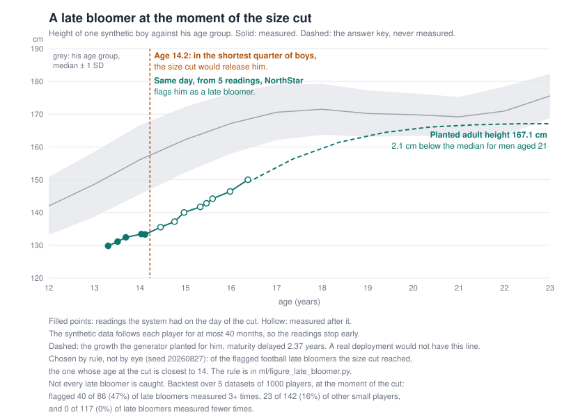

# ML and intelligence

Owner: intelligence/ML workstream. Model code and, just as importantly, the evaluation
harnesses that prove the models hit the graded targets. Reads from the database, writes
results (forecasts, flags, similarity, embeddings) back to it.

## Scope

- **Forecasting** of player trajectories with uncertainty bands. Per-position age curves.
  XGBoost as a challenger to the v1 model, see "Challenger models".
- **Table tennis rating**: a strength for each player from who they played and how many
  points they won, with a range. Graded against hidden ability, see "Table tennis rating".
- **Detectors**: late-bloomer, fraud, duplicate. Measured with precision / recall / F1
  against the **planted ground truth** in the synthetic dataset. Built, see below.
- **Pro tier**: finishing against expected goals, season trends, and a breakout detector
  scored against a synthetic league's answer key. Built, see "Pro tier".
- **Similarity**: player embeddings via sentence-transformers.
- **Anomaly detection**: crosses over with the security workstream (self-submission fraud).
- **LLM assistant**: grounded natural-language queries via a local Ollama model. It phrases
  what the data and models already know; it does not invent player data.

## Evaluation is a first-class deliverable

We are graded on measured performance, so every model ships with a harness:

- **Detectors**: precision / recall / F1 against planted ground truth. Done.
- **Forecasts**: walk-forward validation, MAE / RMSE against two baselines (last-value and
  population-average). A model that cannot beat those baselines is not done. Height done,
  see below.
- **Access control** and **system demo** targets live with their workstreams, not here.

## Running the detector evaluation

```bash
pip install -r data/pipelines/requirements.txt
pip install -r ml/requirements.txt

# the dataset is gitignored, so generate it first
python -m data.pipelines.synthetic.generate

# score every detector against the answer key
python -m ml.run_eval

# write the numbers out as JSON as well
python -m ml.run_eval --json out/detector_scores.json

# generate and score several datasets, to see how much the headline moves
python -m ml.run_eval --seed-sweep 20260827 7 99 404 555
```

Run from the repository root. Tests: `pytest ml/tests`.

To put the detectors' findings in front of users, write them to the database:

```bash
python -m ml.write_flags --dry-run   # report what would be written, roll back
python -m ml.write_flags
```

That is the batch job connecting `ml/detectors` to the application. Until it runs, the
integrity board is empty and the player profile's flag banner never appears, because the API
reads flags from a table rather than recomputing them per request. It is safe to rerun: a case
already raised is recognised rather than duplicated, and a case a reviewer dismissed is not
raised again. See `docs/schema.md` under Flag for the `dedupe_key` that makes that work.

On Windows the player names are Arabic, so a console that is not already UTF-8 will fail
on the error-analysis output. Set `PYTHONIOENCODING=utf-8` before the command.

## Results, v1

**Every number in this file was re-measured on 2026-10-16**, when the generator gained
realistic maturity timing (below). Before that, every child who was not a planted late bloomer
grew on exactly the same timetable, which made both height-based detectors look better than
they are. Where a finding changed the text says so, with the old number, including every place
it got worse. The table tennis rating section is the exception: its results did not move by a
single digit, because nothing in it reads height.

The same day the age-fraud rule gained performance evidence ("Age misrepresentation, v2"
below). That moved only the fraud numbers; late-bloomer, duplicate, forecast and backtest
results are identical to the digit.

On 2026-10-19 the fraud detector gained a third rule, for table tennis results changed by the
player ("Result tampering", below), and the generator plants three such cases per dataset.
That moved the fraud numbers again (up) and the table tennis rating slightly, because a
contradicted match is no longer rated; late-bloomer, duplicate, forecast and backtest results
are identical to the digit, checked against a copy of main.

### Growth timing (2026-10-16)

Real children reach their growth spurt at different ages; the age at peak height velocity
varies by about a year either way. Until 2026-10-16 the generator gave every child the same
timetable and shifted only the planted late bloomers, 1.3 to 2.6 years later. Two things
followed. A late-bloomer detector only had to spot anyone who was off schedule, and a short boy
growing at a normal rate could never resemble a late bloomer, so false alarms were artificially
easy to avoid. The same was true for age fraud: an early maturer, big and finished growing for
his age, is exactly what an older boy under a younger birth date looks like, and there were
none.

Now every child draws a timing offset from a normal distribution with a spread of 0.9 years
(`maturity_tempo_sd_years`), from a random stream of its own, so names, birth dates, adult
heights and the answer key are unchanged and only growth moves
(`data/pipelines/synthetic/tests/test_maturity_tempo.py`). No unplanted child is drawn as late
as the planted range, so the answer key stays complete. What moved, five reported seeds unless
stated:

| | before | after |
| --- | --- | --- |
| late-bloomer F1, 5 seeds / 20 seeds | 0.649 / 0.555 | **0.567 / 0.479** |
| fraud F1, 5 seeds / 20 seeds | 0.747 / 0.726 | **0.642 / 0.638** |
| age-fraud rule, false accusations over 20 seeds | 57 | **112** |
| backtest at 1000 players: late bloomers flagged / other small players flagged | 47% / 16% | **41% / 22%** |
| height forecast MAE under 18 (cohort velocity / XGBoost) | 0.86 / 0.80 cm | **0.94 / 0.86 cm** |
| duplicate F1, table tennis rating | | unchanged |

The new numbers are lower and they are the honest ones. The project's central claim still
holds, with a smaller gap: of the late bloomers a size cut would have released, the system
flags about four in ten of those it has measured three or more times, against about one in
five of the other small boys.

Five datasets, 212 players each. Headline F1 per detector:

| detector | 20260827 | 7 | 99 | 404 | 555 | mean | range |
| --- | --- | --- | --- | --- | --- | --- | --- |
| late_bloomer | 0.522 | 0.615 | 0.533 | 0.750 | 0.417 | **0.567** | 0.417 to 0.750 |
| fraud | 0.688 | 0.718 | 0.848 | 0.774 | 0.690 | **0.744** | 0.688 to 0.848 |
| fraud, before the table tennis rule | 0.640 | 0.688 | 0.846 | 0.720 | 0.609 | 0.700 | 0.609 to 0.846 |
| fraud, v1 (growth only, no table tennis rule) | 0.581 | 0.606 | 0.667 | 0.692 | 0.667 | 0.642 | 0.581 to 0.692 |
| duplicate | 1.000 | 0.957 | 1.000 | 0.909 | 1.000 | **0.973** | 0.909 to 1.000 |

Against the trivial baselines on the committed default seed, where flagging every player
scores F1 0.124 and random selection at the true prevalence scores 0.000 to 0.042.

Read those numbers with the following in mind.

**Thresholds were tuned on seeds 101, 202 and 303, and none of the five reported seeds is
one of them.** Tuning a threshold on the set you then report is the easiest way to publish
a number that does not survive contact with new data. Late-bloomer F1 averaged 0.557 on the
calibration seeds and 0.567 on the reported ones (0.639 and 0.649 before growth timing). The
thresholds were **not retuned** after the timing change: they are the ones chosen on the old
calibration data. Retuning was tried on 2026-10-19, on seeds 101, 202 and 303 only, over a grid
of height cut-offs (-1.2 to -0.5) and growth gates (1 to 6 cm/year). The best mean F1 was 0.589
against 0.557, but only by lowering the growth gate to 1 cm/year, which turns the rule back into
"short" alone; the best setting that keeps the gate (-0.8, 3 cm/year) scored 0.578, better on two
seeds and worse on the third, each by about one case. With 14 late bloomers a dataset that is
noise, so the thresholds were kept and no reported number moved.
The age-fraud rule's three performance thresholds were tuned on those three seeds after the
timing change; there fraud F1 is 0.830 (0.811 before the table tennis rule, 0.682 for v1)
against 0.769 over the 20 reported seeds. The table tennis rule has no threshold to tune.

**Over more seeds the late-bloomer figure is lower.** The relative age audit below needed 20
datasets for its statistics, which also gave a wider look at F1. Over the five above plus
seeds 1000 to 1014 (none used for tuning), mean F1 is **0.479** for late bloomers, **0.769**
for fraud and **0.961** for duplicates (0.555, 0.726 and 0.961 before growth timing; fraud was
0.638 with growth timing and before performance evidence, and 0.741 before the table tennis
rule). The five
reported seeds are kind to the late-bloomer detector (0.567 against 0.479). Quote the 20-seed
figures when a single number is needed; the five-seed table stays because the forecasts and
backtest are reported on the same seeds.

**The spread is wide because the positive classes are small.** Fourteen late bloomers in
212 players means one case moving shifts recall by 7 points, and the 0.583 to 0.720 range
is mostly that. Every table the harness prints carries the raw TP/FP/FN counts and a Wilson
95% interval on recall, so nobody has to take a three-decimal F1 at face value.

**The duplicate score is high because the problem as generated is easy**, not because the
detector is clever. Clones always share sex and sport and sit within a few days of the
original's date of birth, so blocking plus normalised name matching finds nearly all of
them. The honest comparison is against the two controls in the same table: byte-identical
name matching gets recall 0.167, and reading the `merged_into` pointer, which is cheating
because it is the record of a merge a human already did, gets 0.417. Real duplicate
detection at national scale will be harder than this.

**The fraud headline mixes an easy problem with a hard one.** The harness splits them:

| fraud subtype | cases | F1 (default seed) |
| --- | --- | --- |
| implausible self-reported performance | 5 | 1.000 |
| age misrepresentation | 9 | 0.400 (was 0.381 before performance evidence) |
| table tennis result tampering | 3 | 0.857 (3 caught, 1 honest opponent flagged) |

The perfect score on the first is arithmetic, not machine learning: those rows record more
goals than shots, more passes completed than attempted, and distances no human has run, or
for a table tennis carrier, matches both players won. That check belongs in ingest
validation rather than in a model, and it now is: the rule is the sport modules' own check
(`packages/shared/sports`), the same one ingest runs, so a new sport's rules reach the
detector without a change to it. The fact that it scores perfectly is a statement about the
generator. Age misrepresentation is the subtype that
matters, it carries 9 of the 17 cases, and at 0.400 it is doing well under the work the
headline 0.688 on this seed suggests. On this seed the performance evidence (2026-10-16) cut
false accusations from 8 to 3 but also lost one catch (4 to 3), so its F1 barely moved (0.381
to 0.400); over 20 seeds it moved from 0.443 to 0.582, see "Age misrepresentation, v2". It was
0.526 before growth timing and 0.632 before the boys-only change; see Known limits for why.
Anyone quoting the fraud number should quote this one alongside it.

### Result tampering (table tennis, 2026-10-19)

A match between two registered table tennis players is logged by both of them, as two rows
that point at each other (decision 0004). That makes a fraud check possible that football has
no equivalent of: a player who logs a match they lost as a win is contradicted by the
opponent's own row of the same match. The generator plants three such players per dataset (a
lost match rewritten as a win, made self-submitted), on a random stream of its own, so no
other row moves (`data/pipelines/synthetic/planted.py`, `plant_result_tampering`).

The rule (`fraud.detect_result_contradictions`) pairs the two sides' rows of each day off,
one match at a time, and looks at what is left unpaired on both sides. Who is flagged follows
which row can be trusted: against a verified row (coach logged or official), the unverified
side; if neither is verified, both, as one conflict for a reviewer, with a sentence that says
it does not know which is true; if both are verified, nothing, because that is a data error
between two trusted sources, not fraud. A match only one side logged is never evidence: one
in eight registered matches is logged that way, honestly.

| result tampering, pooled | caught | false alarms | missed | F1 |
| --- | --- | --- | --- | --- |
| 20 reported seeds, 60 cases | **60** | 18 | **0** | 0.870 |
| 5 reported seeds, 15 cases | 15 | 3 | 0 | 0.909 |
| calibration seeds, 9 cases | 9 | 2 | 0 | 0.900 |

Every false alarm is the same thing: the honest opponent in a match where both rows were
self-submitted, flagged as the other half of a conflict. None is a contradiction against a
verified row. That cost is the policy working as chosen (a reviewer sees both names and is
told neither is proven); a club that coach-logs its matches never pays it.

The first version missed 2 of the 60 (58 caught, 11 false alarms). A pair that met twice on
one day had one match whose rows agreed, and the rule let the whole day pass; and one planted
case was against a merged duplicate record, which the rule rightly ignores. Both were found on
reported seeds (1000 and 1013) and fixed: rows are now paired one match at a time, and the
generator plants only on matches whose opponent is not a merged record, and only on players
who carry no other planted case (the generator's tests require every label set to be
disjoint, and the first version broke that twice). So the 60 of 60 comes after fixes made with
sight of reported data, and the first version's 58 of 60 is the number to quote alongside it.
The false alarms rose from 11 to 18 with the fixes, only because the planted cases moved to
different matches and more of them had two self-submitted rows.

**What it cannot see:** a win invented outright, over a registered opponent who never logged
the match. One such row looks exactly like the honest one-sided logging above, and only a
pattern of them could be evidence; that was left out on purpose rather than built with a
threshold that would accuse honest players (see Known limits). With the rule, fraud F1 over
20 seeds rose from 0.741 to 0.769. It fell on three seeds (1005, 0.897 to 0.865; 1012, 0.783
to 0.774; 1013, 0.846 to 0.824), each from a conflict flag on an honest opponent.

The age rule's counts in the next sections were measured before this rule existed. Over 20
seeds they now read one false accusation fewer for the rule (49 to 48) and four fewer for the
isolation forest (151 to 147), only because the tampering players are no longer part of the
population the age subtype is scored on.

## Height forecasts, v1

```bash
python -m ml.run_forecast_eval                                  # the default dataset
python -m ml.run_forecast_eval --seed-sweep 20260827 7 99 404 555
```

**How it is validated.** Walk-forward over calendar origins, every 91 days from a year after
the first measurement. At each origin the forecasters see every measurement dated on or before
it, for every player, and nothing after. They forecast each player's readings up to a year
ahead. The origin is shared by all players rather than cut per player, because a per-player
cut would let the population curves learn from other children's later readings.
`test_forecasts_at_an_origin_cannot_see_past_it` rewrites everything after an origin and
checks that the forecasts made at it do not move, and it fails if the leak is put back.

**Headline**: mean absolute error in cm, players under 18 at the origin, five datasets:

| forecaster | 20260827 | 7 | 99 | 404 | 555 | mean |
| --- | --- | --- | --- | --- | --- | --- |
| baseline: last value | 3.26 | 3.08 | 3.23 | 3.23 | 2.94 | 3.14 |
| baseline: population average | 6.27 | 6.78 | 6.75 | 6.52 | 7.07 | 6.68 |
| **cohort velocity** | 0.95 | 0.94 | 0.97 | 0.89 | 0.95 | **0.94** |
| centile tracking | 1.57 | 1.90 | 1.67 | 2.26 | 2.46 | 1.97 |

Cohort velocity is the last reading plus how much the median child of that sex grows between
the two ages, with the growth curve learned from the training window. It beats last value by
70% and population average by 86%, on every seed. RMSE and a player-resampled 95% interval on
MAE are in the full output. Before growth timing it scored 0.86: a child who is early or late
grows off the median curve, which is exactly what this model assumes they do not.

**No constant was tuned against these numbers.** Every threshold in `forecasting/models.py`
was set before the first run and none has changed since. That is also why the adult defect
below is reported and not fixed.

**The uncertainty band** is the band the player profile needs. It is an 80% interval around
cohort velocity built from the errors of earlier forecasts whose outcomes had already been
measured by the origin, so it is walk-forward as well. Observed coverage on the five seeds:
79.7%, 78.3%, 78.2%, 79.5%, 80.4%, at a mean width of about 2.8 cm. Close to the nominal 80% on
every seed, four of them up to two points short (82.5% to 79.5% before growth timing).

Read the headline with these in mind.

**The problem as generated is smooth, so the model is close to the floor.** Synthetic heights
are a growth curve plus 0.55 cm of noise per reading. With that noise on both the last reading
and the target, a perfect forecaster still scores an MAE of about 0.62 cm. Cohort velocity
averages 0.71 up to three months ahead and 1.16 at six to twelve months. Real children are measured on
different stadiometers by different people and grow less tidily, so real error will be higher.

**It gets adults wrong, and last value should be used for them.** Over 18 at the origin, last
value scores 0.64 and cohort velocity 0.93, with a bias of +0.41 cm. The learned velocity
curve is still slightly positive past 18, where there are few players to learn from, so the
model has adults still growing a little. Any forecast shown for an adult
should be a flat line.

**Late bloomers are harder, as they should be.** MAE 1.25 on the planted late bloomers
against 0.94 overall, still about a third of the 3.38 that last value scores on them. Their spurt comes later than
the cohort's, which is the same fact the late-bloomer detector is built on.

**Age fraud makes the forecast run slightly tall, but only slightly.** On the planted
age-misrepresentation cases cohort velocity has a bias of +0.39 cm, against -0.02 for everyone.
The model expects growth for the stated age that the older body has already done. When football
included girls this bias was +0.91 cm and looked like a usable fraud signal; with boys-only
football it is too small to use on its own, and an early maturer runs tall the same way.

**It is much less accurate for girls**: MAE 1.96 cm with a bias of -1.11 (it runs short),
against 0.89 for boys. Girls now play table tennis only, about a dozen per dataset, so their
growth curve is learned from very few children. It still beats last value for girls (2.38),
but not by much. This is the price of a small population, and it is why the profile learns
the uncertainty band separately for each gender (below).

**On the player profile.** The profile drew cohort velocity until the XGBoost challenger
beat it; it now draws XGBoost for under-18s. See "On the player profile" under Challenger
models below. From 18 it still draws a flat line at the last reading, because of the adult
defect above.

## Challenger models

The thesis proposes two machine-learning methods: gradient-boosted forecasting (XGBoost) and
isolation-forest anomaly detection. The v1 models above are transparent rules and curves that
already beat the graded baselines. `ml/challengers/` puts the two proposed methods through the
**same** evaluation, on the same seeds, with every setting fixed before the first run, so the
question "does the more complex model earn its place?" is answered with numbers.

```bash
python -m ml.run_forecast_eval --seed-sweep 20260827 7 99 404 555      # includes XGBoost
python -m ml.run_eval --seed-sweep 20260827 7 99 404 555 $(seq 1000 1014)  # includes the forest
```

The isolation forest needs scikit-learn (`ml/requirements.txt`); XGBoost is pinned in
`apps/api/requirements.txt`, because the profile now runs it. Without them the harness runs
the v1 models alone and says the challengers were skipped.

### Height forecast: XGBoost wins, mostly on the hard cases

XGBoost learns the change in height from eight numbers known at the last reading, including
cohort velocity's own answer and the player's own recent growth rate, so it can learn when to
trust the child over the cohort. It trains inside each walk-forward snapshot, and the same
no-lookahead test that guards the v1 models passes for it (`test_challengers.py`).

MAE in cm, mean of five seeds, same cases for every model:

| group | XGBoost | cohort velocity | last value |
| --- | --- | --- | --- |
| **under 18 (headline)** | **0.86** | 0.94 | 3.14 |
| boys under 18 | 0.85 | 0.89 | 3.18 |
| girls under 18 | **1.15** | 1.96 | 2.38 |
| planted late bloomers | **1.01** | 1.25 | 3.38 |
| 6 to 12 months ahead | 1.04 | 1.16 | 4.57 |
| 18 and over | 0.67 | 0.93 | **0.64** |

It wins on all five seeds (0.92, 0.85, 0.82, 0.87, 0.86 against 0.95, 0.94, 0.97, 0.89, 0.95),
though the per-seed 95% intervals overlap. Before growth timing the headline was 0.80 against
0.86; both got worse by about the same amount. Read it this way:

- **For boys it is a little better** (0.85 against 0.89). On the smooth growth the generator
  makes, cohort velocity is already close to the 0.62 cm noise floor, and there is little left
  to learn.
- **The gain is on the hard cases.** Girls: 1.15 against 1.96, because XGBoost learns from
  boys and girls together with gender as one input, instead of a girls-only curve from a dozen
  children. Late bloomers: 1.01 against 1.25, because it can follow the child's own late spurt.
- **It mostly fixes the adult defect** (0.67 against cohort velocity's 0.93, bias +0.04
  against +0.41), but last value is still the best model for adults.
- **Age fraud:** its bias on planted cases is +0.37 against +0.39, the same small "runs tall"
  signal noted above.

**Its band holds, per gender.** The profile learns its 80% band for each gender separately,
from earlier forecasts whose outcome was already measured. Checked that way (walk-forward,
under 18, pooled over the five datasets; printed at the end of the sweep):

| band around | boys: inside | boys: width | girls: inside | girls: width |
| --- | --- | --- | --- | --- |
| cohort velocity | 79.0% of 12,550 | 2.70 cm | 80.2% of 126 | 4.72 cm |
| **XGBoost** | **79.8%** of 11,197 | **2.64 cm** | **78.3%** of 106 | **2.70 cm** |

For boys both are close to the nominal 80%, XGBoost's a little closer and a little narrower.
For girls both are near nominal and XGBoost's band is 43% narrower, though a hundred checks is
a small sample (before growth timing the girls' bands covered 73.0% and 77.4%). XGBoost has fewer checks because it declines at the earliest
origins, when there are too few readings to train on (fewer than 200 pairs).

**On the player profile.** The API runs this same code, not a copy
(`apps/api/app/services/forecast.py`), on the rows in its own database. Under 18 it draws
XGBoost 3, 6 and 12 months ahead; from 18 a flat line at the last reading, because last value
is still the best model for adults. The band comes from XGBoost's own past errors on that
database, per horizon and per gender, and the profile states how many past readings for that
gender fell inside it. On the local synthetic dataset, measured before growth timing: 81% for
boys (2,130 of 2,637), 81% for girls (42 of 52). It draws nothing, and says why, when a player has fewer than two readings,
no date of birth or gender, a last reading more than a year old, or fewer than 30 past
forecasts for their age group and gender in a horizon (adult girls, on the synthetic data).
`apps/api/tests/test_forecast.py` checks that the profile's number equals the evaluated
forecaster's, and `ml/tests/test_challengers.py` that it trains without scikit-learn, which
the API image does not have.

The model takes about nine seconds to build inside the API container (a walk-forward run with
an XGBoost fit at every origin). The API builds it in the background when it starts and
rebuilds it in the background every five minutes, so a profile does not wait for it. A
player's own readings are read fresh on every request, so a height a coach has just logged
moves that player's forecast at once.

### Age misrepresentation, v2: performance evidence (2026-10-16)

Growth timing gave the synthetic data early maturers, and growth data alone cannot tell one
from an older boy under a younger birth date: both are big for the stated age and finished
growing. The generator already made age cheats play above the age group on their record
(`performance_outlier_for_stated_age`), and v1 ignored it. v2 reads it.

**The feature** (`features.output_z`). How much a player produces for the time played, from
the counts that measure volume rather than skill or results: shots and key passes per minute
in football, service winners and unforced errors (counting against) per set in table tennis
(`features.OUTPUT_RATES`). Each count is divided by the median for the same sport and position,
because a striker shoots more than a centre back for reasons that have nothing to do with age;
then the result is a z score against the stated-age cohort, the same pooled (sport, gender,
age) construction as height. Rows that fail their sport module are skipped, and a player with
under 450 minutes or 20 sets has no output score. It never reads true age or the answer key.

**The rule** (`fraud.detect_age_misrepresentation`). An accusation needs two lines of evidence:

- growth-led: the v1 growth rule (unchanged, mismatch at least 1.8) **and** output at least
  0.5 above the stated-age cohort. An early maturer who plays like his age group is no longer
  accused.
- performance-led: output at least 1.25 above the cohort **and** height at least 1.0 above
  it. This reaches boys claiming 11 to 13 whose spurt has not started yet.

A player with no output score is judged on growth alone, as before, and the sentence says so.

**How it was tuned.** On seeds 101, 202 and 303 only, with v1's growth threshold kept, over
a grid of the three new thresholds. The setting chosen is not the best calibration F1: 0.5,
1.25 and 0.5 scored 0.723 there against 0.682, but in the what-if below it made more false
accusations than v1. The chosen one made fewer false accusations than v1 and more catches in
both worlds, and its neighbours in the grid score the same, so it is not a lucky spike.
Calibration seeds, 27 cases: v1 caught 12 with 10 false accusations (F1 0.490), v2 caught 15
with 2 (0.682).

**Results, counts pooled over the 20 reported seeds (180 planted cases):**

| | caught | false accusations | precision | recall | F1 |
| --- | --- | --- | --- | --- | --- |
| v1, growth only | 83 | 112 | 0.426 | 0.461 | 0.443 |
| **v2, growth and performance** | **94** | **49** | **0.657** | **0.522** | **0.582** |
| v2 in the what-if below | 95 | 82 | 0.537 | 0.528 | 0.532 |

False accusations fall from 112 to 49 and catches rise from 83 to 94. Fraud F1 rose on 18 of
the 20 seeds and fell on two: 555 (0.667 to 0.609) and 1010 (0.667 to 0.621).

**By stated age, 20 seeds** (false accusations here also count the few metric-fraud players
the age rule flags, which the table above sets aside, so they sum to 114 and 50):

| stated age | 11 to 13 | 13 to 15 | 15 to 17 | 17+ |
| --- | --- | --- | --- | --- |
| v1 caught | 10/61 | 50/71 | 16/28 | 7/20 |
| **v2 caught** | **36/61** | 46/71 | **9/28** | **3/20** |
| v1 false accusations | 15 | 22 | 69 | 8 |
| v2 false accusations | 10 | 10 | 26 | 4 |

The gain is in the youngest band, which growth could not reach. **The older bands got worse**:
15 to 17 went from 16 catches to 9 and 17+ from 7 to 3. In the generator an age cheat's
performance edge is the ratio of his maturity at his true age to the maturity at his recorded
age, and that ratio shrinks toward 1 as both ages near adult size, so an older cheat no longer
outplays his recorded age group and the growth flag goes uncorroborated. Whether that holds in
real football is unknown: an extra two years of training may show in performance long after
the body has stopped growing, and the generator does not model it.

**The what-if: performance follows maturity for everyone.** The generator moves only growth
with maturity timing; an honest early maturer is big but plays like his age group. Real
academies are not that kind, since an early maturer's size wins games too. So part of v2's
gain could be the generator's doing. To bound it, `players.PERFORMANCE_FOLLOWS_MATURITY`
makes every child's performance follow his own maturity (off in every number above, on with
`--performance-follows-maturity`). Same seeds and same planted cases. v2 then catches 95 with
82 false accusations: still fewer than v1's 112 (v1 reads no performance, so it does not
change), but about half of the drop disappears. By stated age, false accusations in the two
youngest bands are **higher than v1's** (19 against 15, and 25 against 22), and lower above 15
(35 against 69, 6 against 8). Read the true effect as somewhere between the two worlds: real
performance mixes body and years of play, and the generator can only show the two extremes.

```bash
python -m ml.run_eval --seed-sweep 101 202 303                                       # calibration
python -m ml.run_eval --seed-sweep 20260827 7 99 404 555 $(seq 1000 1014)           # reported
python -m ml.run_eval --seed-sweep 20260827 7 99 404 555 $(seq 1000 1014) --performance-follows-maturity
```

### Age misrepresentation: isolation forest ties v1, and v2 beats both

The forest is fitted on growth features of the same eligible players as the rule, with no
labels and no prevalence given to it (`contamination="auto"`), and it flags only anomalies in
the direction age fraud points: big for the stated age and no longer growing. An isolation
forest also isolates small, fast-growing children, who are late bloomers, and calling them
frauds is the worst mistake this platform could make; `test_challengers.py` guards it.

Counts pooled over 20 seeds, same 180 planted cases for both:

| | caught | false accusations | precision | recall | F1 |
| --- | --- | --- | --- | --- | --- |
| rule (v1, growth only) | 83 | 112 | 0.426 | 0.461 | 0.443 |
| isolation forest | **95** | 151 | 0.386 | **0.528** | 0.446 |
| rule (v2, growth and performance) | 94 | **49** | **0.657** | 0.522 | **0.582** |

Against v1 the F1 scores are a tie. The forest catches 12 more cases at the cost of 39 more
false accusations. For a flag that accuses a child of lying about their age, a false accusation
costs more than a miss, so the rule stayed. v2 now catches one case fewer than the forest with
a third of its false accusations. The comparison is not quite even: the forest sees growth
features only. Giving it the output score too is the fair next round. The forest shows no relative age bias either (false
positive rate 3.3% to 4.7% across quarters, p = 0.38).

**Both got much worse with growth timing, and the reason matters.** Before it the rule made 57
false accusations over these 20 seeds and caught 92 cases (F1 0.559); the forest 102 and 112
(0.569). An early-maturing boy is big for his age and has finished his spurt, which is what an
older boy under a younger birth date looks like, and until 2026-10-16 the synthetic data had no
early maturers. Real academies do. Performance evidence (v2, above) is the answer that worked,
with the caveats in that section.

### Late bloomers by growth timing: the rule stays

```bash
python -m ml.challengers.tempo_fit --seed-sweep 101 202 303            # calibration
python -m ml.challengers.tempo_fit --seed-sweep 20260827 7 99 404 555   # reported
```

Of the 18 late bloomers v1 missed on the calibration seeds, 17 were missed because they were
**not short**: a late-maturing boy with tall parents looks ordinary at 13. What sets him apart
is timing, so `challengers/tempo_fit.py` estimates it the way growth research does (SITAR: size,
tempo, velocity). Each child's readings are fitted to the dataset's own median growth curve,
shifted in time by `tau` and scaled in size by `A`, with weak priors on both because over a
short series a small child on time and a big child running late draw the same points. A fitted
`tau` of 0.8 years or more is a flag. Standard library only. Tuned on seeds 101, 202 and 303
only; the module docstring records every step, including the two versions that did worse.

| reported seeds, settings frozen | mean F1 | caught | false alarms | missed |
| --- | --- | --- | --- | --- |
| **v1 rule** | **0.567** | 36 | **21** | 34 |
| timing fit | 0.477 | **44** | 69 | **26** |
| v1 or a timing flag of 1.8+ years | 0.554 | 39 | 31 | 31 |
| v1 or a SITAR timing flag of 1.4+ years (2026-10-25) | 0.549 | 39 | 33 | 31 |
| SITAR timing fit alone, 1.4+ years | 0.346 | 19 | 20 | 51 |

The timing fit finds more late bloomers and accuses three times as many other children, so
**v1 stays**. The likeliest reason is the reference curve: it is cross-sectional, a median of
children caught at different points in their spurts, and so flatter than any one child's.
Fitted against it, the planted late bloomers (delayed 1.3 to 2.6 years) came out at a median of
0.85. Real SITAR fits the curve and the shifts together, and has more years per child than the
14 to 40 months the synthetic data follows. Both are where to start if this is picked up again.

**Picked up again on 2026-10-25, and it lost again** (`challengers/sitar.py`). This one fits the
curve and every child's shift and size together, re-estimating the curve from everyone's
aligned readings until it settles, as SITAR proper does. Its threshold was chosen on seeds 101,
202 and 303 (best there: v1 or a fitted delay of 1.4+ years, 0.585 against v1's 0.557, the best
of eight thresholds) and committed before the reported seeds were run once. Reported, it adds 3
late bloomers and 12 false alarms, and v1 stays.

The finding worth keeping: the joint curve moved the planted late bloomers' fitted delay only
from about 0.85 years to about 1.05 (0.95 to 1.12 by seed), against true delays of 1.3 to 2.6.
The curve was not what held it back. Over 14 to 40 months of readings per child, the prior that
keeps a small child on time from reading as a big child running late pulls every timing estimate
toward zero. That held even though the generator grows children exactly as SITAR assumes (a
size factor and a time shift of one curve), so this was the method's best case; real children,
whose curves also differ in shape, would do no better. **Timing needs more years of readings per
child, not a cleverer fit over the same short records.** That is a practical recommendation as
much as a modelling one: measure at intake and keep measuring.

    python -m ml.challengers.sitar --seed-sweep 101 202 303 --thresholds 0.6 0.8 1.0 1.2 1.4 1.6 1.8 2.0
    python -m ml.challengers.sitar --seed-sweep 20260827 7 99 404 555

### What this says

Neither method was a wasted experiment, and neither is a free win. The more complex forecaster
earns its place where the simple one is known to struggle (few children to learn from, late
spurts), and the unsupervised detector does not beat a well-reasoned rule on the metric that
matters for an accusation. That matches the literature review's conclusion that evaluation
design, not model complexity, is the constraint.

## Table tennis rating

A table tennis win rate says nothing about who the wins were against. Decision 0004
(`docs/decisions/0004-table-tennis-opponent-strength.md`) records the opponent of every match,
and this section grades two ways of turning those matches into a rating. The generator hides
each player's true ability (`table_tennis_ability` in `ground_truth.json`), so the ratings
can be checked against it. That is not possible with real data.

```bash
python -m ml.run_rating_eval                       # the reporting seeds, numbers below
python -m ml.run_rating_eval --tune                # the tuning run, seeds 101, 202, 303 only
python -m ml.run_rating_eval --schedule by-level   # the what-if below
```

The two models, and what they are compared with:

| | uses | code |
| --- | --- | --- |
| **Glicko-2** | who won each match | `rating/glicko2.py`, checked against Glickman's worked example |
| **point rating** | every point, adjusted for the opponent (Bradley-Terry on points, with a prior and a standard error) | `rating/points.py` |
| match win rate, point win rate | every row, any opponent | what the profile shows today |

Every method sees the same matches. A match counts toward a rating only when something more
than the player's own word stands behind it: a non-self-submitted row, or both players
logging it. A claimed win over a strong player is worth faking, so an unconfirmed one does
not move a rating.

### Results, reporting seeds 20260827, 7, 99, 404 and 555 (mean over the five)

Ranking, Spearman correlation with hidden ability, within gender (girls and boys never meet,
so their ratings are separate scales; 54 girls and 121 boys over the five seeds):

| | girls | boys |
| --- | --- | --- |
| **point rating** | **0.907** | **0.893** |
| Glicko-2 | 0.817 | 0.800 |
| point win rate | 0.819 | 0.859 |
| match win rate | 0.749 | 0.815 |

Predicting matches it has not seen (walk-forward, from the seventh month on; lower is better
for Brier and log loss):

| | Brier | log loss | favourite won |
| --- | --- | --- | --- |
| **point rating** | **0.1924** | **0.5642** | **0.701** |
| point win rate | 0.1965 | 0.5769 | 0.688 |
| match win rate | 0.2034 | 0.5929 | 0.690 |
| Glicko-2 | 0.2079 | 0.6078 | 0.693 |
| coin flip | 0.2500 | 0.6931 | |

**The point rating wins, and it is what the profile shows.** It orders players better than
anything else (Spearman 0.09 higher than point win rate for girls, 0.03 for boys) and predicts results
better, though by a modest margin (log loss 0.564 against 0.577). Its range is honest: the
profile shows it only when the range of point share is at most 7 points wide, which covers
171 of 175 players, and for 168 of those 171 (98%) the player's true chance of winning a
point against an average opponent lies inside it. Nominal is about 95%, so the range is
slightly cautious, which is the safe side.

**Glicko-2, the method the decision first chose, loses to the plain point win rate** on both
questions. A match is one bit, won or lost; a match is also about ninety points, and the share
of them won carries far more about a player than the result does. Glicko-2 is also badly
overconfident here: on tuning seed 101, when it gave the favourite 80 to 90%, the favourite
won 68% of the time. The implementation is right (it reproduces the paper's example to two
decimals); the method throws away most of the evidence. It stays in `rating/` as the measured
alternative.

The point rating also learns from matches against opponents who are not on the platform. All
of a gender's outsiders are treated as one stand-in opponent whose strength the fit learns,
rather than assumed to be average. Without them it predicted worse than point win rate on the
tuning seeds (log loss 0.549 against 0.535); with them, better (0.530).

### What if strong players mostly met strong fields?

The generator picks opponents by age and gender, not by level, so a raw rate is fooled only a
little. Real competition is often tiered (divisions, seeded events). The what-if run makes
opponents close in level, with nothing retuned:

| Spearman, by-level schedule | girls | boys |
| --- | --- | --- |
| **point rating** | **0.785** | **0.682** |
| Glicko-2 | 0.728 | 0.588 |
| point win rate | 0.570 | 0.410 |
| match win rate | 0.536 | 0.304 |

When everyone plays their own level, everyone wins about half their matches, and a win rate
says almost nothing (0.30 for boys). Opponent adjustment is what keeps the ranking. Two
results here are unflattering and stay in. First, **no method predicts matches better than a
coin flip** in this world (point rating log loss 0.715 against 0.693): the matches are close
by construction and every method, tuned on the default schedule, is overconfident. Second,
the point rating's range covers the truth for only 123 of 148 shown players (83%), short of
its nominal 95%. Real data will sit somewhere between the two schedules, and which end it is
nearer is unknown until the ITTF and WTT results are ingested.

### Limits

- **Hidden ability does not change over time** in the generator. A junior improves; a rating
  built on two years of matches lags them. Real data will be harder.
- **Girls are about eleven per dataset**, so the girls' column rests on few players.
- **The point model has the generator's shape.** The generator draws points from the ability
  gap and the point rating models points from a strength gap, so it is fitting a model of the
  right family. Real points are not independent coin flips (serve rotation, momentum); the
  model will fit real data less well than this.
- **Settings were tuned on seeds 101, 202 and 303**: Glicko-2 tau 0.5 (no setting tried made
  a difference), point rating prior 0.15, display range 0.07, baseline slopes 3 and 20.

## Pro tier

```bash
python -m ml.run_pro_eval            # the reporting seeds, the numbers below
python -m ml.run_pro_eval --tune     # the grid, on the tuning seeds 101, 202 and 303 only
```

Measured on 2026-10-27 against the synthetic Egyptian Premier League
(`data/pipelines/synthetic/pro_league.py`): 18 clubs of 24 players, three seasons of simulated
matches, with an answer key. The league is built in memory from the seed, so there is no
export to go stale. Code in `ml/pro`; the profile runs the same code
(`apps/api/app/services/pro.py`, `GET /players/{id}/pro-seasons`).

### Breakouts

The answer key: in each season after the first, about 8% of players aged 18 to 23 get a large
jump in quality (planted, 118 cases over the five reporting seeds). The detector is told
nothing about them. It compares each young player's season with their previous one.

**v1** measures a player's share of their team's chances: non-penalty expected goals plus
expected assists (npxG + xA) per 90 minutes, divided by the team's per match, and flags a log
rise of at least 0.11. The **first version**, kept as a comparison, used the bare per-90 rate
plus a little weight on the rise in minutes. The **baseline** flags a young player whose
minutes rose by a quarter of a season or more. Every setting was chosen on seeds 101, 202 and
303:

| Tuning seeds, pooled | F1 |
|---|---|
| v1, team share, threshold 0.11 | 0.833 |
| first version, per 90 rate, threshold 0.15, minutes weight 0.1 | 0.686 |
| minutes only, rise of 0.25 of a season | 0.298 |

The team share was the change that mattered. When a whole club gets better, every player's
per-90 rate rises with it; their share of the team's chances does not.

Reporting seeds 20260827, 7, 99, 404 and 555 (pooled; 95% Wilson intervals):

| | TP | FP | FN | precision | recall | F1 |
|---|---|---|---|---|---|---|
| **v1** | 81 | 45 | 37 | 0.643 [0.56, 0.72] | 0.686 [0.60, 0.76] | **0.664** |
| v1 without the age window | 81 | 107 | 37 | 0.431 [0.36, 0.50] | 0.686 [0.60, 0.76] | 0.529 |
| first version, per 90 rate | 70 | 50 | 48 | 0.583 [0.49, 0.67] | 0.593 [0.50, 0.68] | 0.588 |
| minutes only | 44 | 136 | 74 | 0.244 [0.19, 0.31] | 0.373 [0.29, 0.46] | 0.295 |

What this says, including the parts that are not flattering:

- **v1 beats both comparisons out of sample**, by 0.08 F1 over the first version and more than
  double the minutes-only baseline. The F1 drops from 0.833 on the tuning seeds to 0.664 on the
  reporting seeds, which is the honest number.
- **It swings a lot by seed**: F1 0.826, 0.392, 0.809, 0.471 and 0.857. Seeds 7 and 404 each
  have 18 false alarms. Looking at them (error analysis only; nothing was changed because of
  it): they are ordinary young players growing at the normal yearly rate, often in a season
  where their minutes fell, so their share is measured on fewer minutes and is noisier. A
  minimum on minutes, or a rule that minutes must not fall, is the obvious next thing to try,
  and it must be tried on the tuning seeds, not these.
- **The age window does a lot of the work.** Without it precision falls from 0.64 to 0.43.
  The window is the scouting meaning of a breakout, but it is also exactly where the answer
  key plants them, so on real data the gain from it will be smaller.
- **What v1 cannot see**: 11 of the 118 breakouts came after a season with fewer than 270
  minutes, so there was nothing to compare against, and 1 had fewer than 270 minutes in the
  breakout season itself. Breakouts from the bench are missed by design.

### Finishing against expected goals

A season's non-penalty goals are judged against its npxG: "above" or "below" only outside the
10th to 90th percentile of what an ordinary finisher scores from those chances (a Poisson
range), and no verdict at all below 2.0 npxG. The answer key is each player's true finishing,
planted in the league: about 4% are genuinely better finishers, 4% worse, and the rest
ordinary. Reporting seeds, summed:

| | count | truly better finishers among them |
|---|---|---|
| one season called "above" | 129 | 9 (7%) |
| all seasons pooled, called "above" | 105 | 10 (10%) |

- **One season above expected is nearly always luck.** Of 129 seasons called "above", 9
  belonged to a genuinely better finisher, against about 4% in the population. Pooling three
  seasons helps a little (10%) but not much: 3 seasons of chances is still too few.
- **Real finishers are hard to find from season totals**: of 58 genuinely better finishers
  with enough chances to judge over all their seasons, 10 were called "above".
- **The range is conservative**: ordinary finishers' seasons were called above or below 13% of
  the time (199 of 1,506), less than the 20% a 10th to 90th percentile range implies, because
  goals are whole numbers.

So the screen says "above expected" as a fact about the season and explains that it rarely
lasts; it never calls a player a good finisher.

**What predicts next season's goals?** For 2,636 consecutive seasons with 900 minutes or more
each, in the same competition, next season's non-penalty goals per 90 predicted from this
season's numbers (mean absolute error, mean over the five seeds):

| predicted by this season's | MAE |
|---|---|
| **npxG per 90** | **0.0461** |
| position average | 0.0584 |
| goals per 90 | 0.0623 |

Expected goals predict next season's goals 26% better than goals do, and goals do worse than
simply assuming the position's average. This is the published finding on real leagues
reproduced in the synthetic one, which is what the league was built to do; it is a check on the
league as much as a result.

### Trends

Not scored, since there is nothing to score them against: season-on-season changes in nine
rates (npxG, goals, xA, key passes, dribbles won, tackles and interceptions per 90; pass
completion and duels won), shown only when both seasons have 900 minutes, and always as the two
rates rather than a percentage change.

### Limits

- **It is a synthetic league.** Breakouts are a single jump in quality, planted where the
  detector looks. Real breakouts are slower, and real minutes depend on transfers, injuries
  and managers, none of which the league has. Stage 5 of the pro tier checks the analyses
  against StatsBomb's open event data.
- **Players abroad are not scored for breakouts**: their clubs' other players are not in the
  data, so there is no team share. The reason on the profile says so.
- **Not yet a flag.** A breakout shows on the profile's league seasons card, not on the
  integrity board or in the "What the models are saying" banner.

## Team gap analysis

```bash
python -m ml.run_gap_eval            # the reporting seeds, the numbers below
python -m ml.run_gap_eval --tune     # the tuning seeds 101, 202 and 303; chooses the minimum minutes
```

Decision 0003. Where a club is weak against its league, and which players from other clubs are
strong exactly there; or, in national team mode, needs the federation names, answered from every
Egypt-eligible player, each ranked only within their own league. Code in `ml/pro/gaps.py`; the
team statistics, their direction, the position groups and the links from a team weakness to
player statistics are config (`teamGaps` in `packages/shared/sports/football.json`). The screen
is `/gaps`, for scouts and federation staff.

There is no answer key for "the right signing", so this is not scored like a detector. What is
measured is whether its numbers are stable enough to act on: one season of the synthetic league
(`pro_league.build_halves`) is played as two halves of 17 matches, and every statistic is
computed from each half. Measured on 2026-10-28.

### Team statistics

Correlation across the 18 teams between the first and second half (mean over seeds), and how
often a bottom-third team in one half is bottom third in the other (chance alone: a third):

| | tuning r | reporting r | reporting, bottom third kept | treated as |
|---|---|---|---|---|
| Chances made (xG per game) | 0.78 | 0.85 | 73% | stable |
| Chances allowed (xG against per game) | 0.83 | 0.83 | 77% | stable |
| Shots allowed per game | 0.71 | 0.64 | 67% | stable |
| Possession | 0.90 | 0.90 | 93% | stable |
| Points per game | 0.17 | 0.28 | 33% | not stable |
| Goals above xG per game | -0.07 | 0.03 | 43% | not stable |
| Goals conceded above xG per game | 0.01 | -0.02 | 40% | not stable |
| Set piece goals per game | 0.13 | 0.24 | 47% | not stable |
| Set piece goals conceded per game | -0.01 | 0.17 | 43% | not stable |
| Goals conceded in the last 15 minutes | 0.03 | 0.17 | 40% | not stable |

A statistic is stable when its season figure's reliability (Spearman-Brown, 2r / (1 + r), from
the tuning seeds' r) is 0.7 or more. A club in the bottom third on an unstable statistic is
shown that rank, with a sentence saying it barely repeats, and no players are proposed for it.
The flags live in the config (`"stable": false`), and `ml/tests/test_gaps.py` fails if they stop
matching the measurement.

What this says: the **underlying** numbers (chances made and allowed, possession) are what a
weakness can be built on. **Results and finishing are not**: points, goals against xG at both
ends and late goals are mostly chance over half a season. Set pieces are unstable here partly
because the synthetic league has no set-piece skill at all (a set-piece goal is a random share
of goals); on real data they may repeat better, and the check must be rerun there.

### Player statistics and the minimum minutes

Within position group, the season reliability of each player statistic, for players with half
the threshold or more in each half (reporting seeds):

| minutes in the season | 300 | 450 | 900 | 1800 |
|---|---|---|---|---|
| npxG per 90 | 0.93 | 0.93 | 0.93 | 0.93 |
| xA per 90 | 0.94 | 0.94 | 0.93 | 0.93 |
| Passes per 90 | 0.96 | 0.96 | 0.97 | 0.98 |
| Pass completion | 0.80 | 0.81 | 0.83 | 0.83 |
| Dribbles won per 90 | 0.74 | 0.74 | 0.81 | 0.83 |
| Shots per 90 | 0.72 | 0.74 | 0.77 | 0.73 |
| Key passes per 90 | 0.70 | 0.72 | 0.74 | 0.73 |
| Crosses per 90 | 0.62 | 0.63 | 0.68 | 0.75 |
| Tackles per 90 | 0.53 | 0.55 | 0.64 | 0.67 |
| Interceptions per 90 | 0.48 | 0.47 | 0.53 | 0.62 |
| Clearances per 90 | 0.37 | 0.46 | 0.60 | 0.64 |
| Aerial duels won | 0.35 | 0.38 | 0.47 | 0.52 |
| Duels won | 0.32 | 0.36 | 0.39 | 0.35 |
| **median** | 0.70 | 0.72 | 0.74 | 0.73 |

- **The minimum is 450 minutes**, not the 900 decision 0003 started from. The rule, fixed before
  measuring, is the smallest threshold at which the median statistic's season reliability
  reaches 0.7, on the tuning seeds (0.73 at 450 there; 300 on the reporting seeds). The median
  barely moves with minutes, because a higher threshold also keeps only regulars, who are more
  alike.
- **The defensive statistics are the weak ones**: tackles, interceptions, clearances, duels won
  and aerial duels won are below 0.6 at 450 minutes on the tuning seeds, so they are marked
  (`"lowReliability": true`) and the screen stars them with "weigh it less". Duels won never
  reaches 0.4 at any minutes.
- **The attacking statistics are too reliable to believe.** npxG and xA per 90 at 0.93 reflect
  how the synthetic league shares out a team's chances (by role, minutes and one attribute),
  which is cleaner than real football. Expect lower numbers on real data, where the check must
  be rerun before the minimum is trusted.

### Limits

- **One team strength.** The synthetic league draws each match from a single strength per team,
  so a team weak at making chances is usually weak at preventing them too. Real teams have
  shapes; the analysis handles them, but this data does not test that it finds them.
- **Players abroad are not ranked.** Their leagues have one or two players of a group on record,
  so there is no population to place them in; national team mode lists them with their raw
  numbers and says why. Ranking them needs league-wide data for those leagues.
- **Not validated against what a player is really good at.** The league knows every player's true
  attributes, so whether a high tackles percentile means a good defender could be measured; that
  is a next step, not done here.
- **Candidates come from the club's own league** in club mode, so every percentile is among the
  same players.

## Player similarity

```bash
python -m ml.run_similarity_eval --seed-sweep 101 202 303                              # tuning
python -m ml.run_similarity_eval --seed-sweep 20260827 7 99 404 555                    # reported
python -m ml.run_similarity_eval --seed-sweep 20260827 7 99 404 555 $(seq 1000 1014)   # 20 seeds
```

"Players like this one", for football and table tennis (`ml/similarity.py`). Each player's
profile is their own record scaled to the time played: football per 90 minutes (shots, shots
on target, goals, assists, key passes, tackles, passes attempted, distance) plus pass
completion; table tennis per set (service winners, unforced errors) plus the share of points
and sets won. Each statistic is standardised within the sport and players are compared by
distance, only within the same sport and gender. A profile needs 450 minutes or 20 sets on
record, skips rows the sport module says cannot be true and rows the opponent's own row
contradicts, and never reads position or the answer key. Standard library only.

**What it can be graded on, and what not.** The generator draws a footballer's statistics from
their position and one hidden number, ability, which scales only shots and key passes; a
table tennis player's from ability alone. So in this data "similar" can only mean the same
role and the same level, and those are the two things graded. Real players differ in style in
ways this data does not have; nothing here says how well it finds that. The statistic list
and K = 5 were fixed before the first run and nothing was tuned.

Pooled over 20 seeds (the five reported seeds alone, and the tuning seeds, agree within a few
points):

| | the 5 most similar players | chance or random | the obvious single number | best possible |
| --- | --- | --- | --- | --- |
| football, same kind of position (never read) | **73%** | 28% | | |
| football, level: share of the gap from random to best | **37%** | 0% | 27% (shots per 90) | 100% |
| table tennis, level | **85%** | 0% | 72% (share of points won) | 100% |
| table tennis, same playing style (not used by the generator) | 27% | 26% | | |

Read it this way:

- **It finds role.** Without reading position, nearly three in four of a footballer's most
  similar players play the same kind of position, against fewer than three in ten by chance.
  Passing, tackling and distance give a role away.
- **It beats the obvious single number on level, in both sports**, but in football only
  modestly: it closes about a third of the gap between random and perfect. Most of a
  footballer's profile carries no ability in this data (only shots and key passes do), so the
  rest is noise for this question. Real data, where more statistics reflect quality, should do
  better here; that is untested.
- **It does not find what is not there.** Playing style in table tennis is recorded but the
  generator never uses it, and the most similar players share a style at chance. A method that
  beat chance there would be fitting noise.
- **Table tennis level comes mostly from the share of points won**, which is close to what the
  rating in the previous section measures, against opponents of any strength. The rating is
  the better number for level; similarity adds which kind of player.

## Assistant

```bash
cd apps/api
python -m eval.run_assistant_eval --split dev  --model qwen2.5:3b    # what the prompt was tuned on
python -m eval.run_assistant_eval --split test --model qwen2.5:3b    # held out, reported
```

The Ask screen takes a question in English or Arabic (`apps/api/app/services/assistant.py`).
A local model **reads** the question into a fixed form: what kind of question it is (best in a
group, one player, players like one player, a comparison, or none of these), and the sport,
gender, position group, ages, statistic and player names it mentions. The platform then
**answers** it with the services the other screens use, as the person asking. The model writes
no part of the answer, so the only thing to measure is how often it reads the question right.

A reading counts as right when everything that changes the answer is right. Both sides are
compared after the assistant's own defaults (no sport means football, and football means
boys and men), and names are compared ignoring case, spacing and order. There are 72 questions
with known readings (`apps/api/eval/assistant_questions.json`), a quarter of them in Egyptian
Arabic, in two halves of 36. The prompt was written against `dev`. `test` was written at the
same time, before any run, and was scored only after the prompt was final.

| | dev | **test (held out)** | seconds per question, median on test |
| --- | --- | --- | --- |
| qwen2.5:3b, first prompt | 11 of 36 (31%) | | 1.7 (on dev) |
| qwen2.5:7b, first prompt | 31 of 36 (86%) | | 18.9 (on dev) |
| **qwen2.5:3b, final** | 33 of 36 (92%) | **32 of 36 (89%)** | **1.9** |
| qwen2.5:7b, final | | 33 of 36 (92%) | 14.5 |

Three changes took the 3B model from 31% to 92% on dev:

1. **Consistency rules on its own reading.** A question with no player names cannot be about
   one player or a comparison, so it becomes "best in a group" when it names a statistic, a
   position, a sport, a gender or an age, and "none of these" otherwise. Two or more names make
   a comparison. These rules do not guess at the question; they make the model's reading agree
   with itself.
2. **Ages by fixed rule, not by the model.** "Under 16" means 15 and under, "U14" 13 and
   under, "over 16" 17 and over, "16+" 16 and over, and the Arabic forms (تحت، فوق، سنة, with
   Arabic digits) likewise. The model's commonest mistake on dev was "under 16" read as "aged
   15".
3. **Eight worked examples** in the prompt, written for it: none is a question from either half.

**The 3B model is the default, and the 7B is not, on purpose.** On the held-out half the 7B
gets one more question right and takes almost eight times as long. The 3B fits wholly in a
4 GB GPU; the 7B does not and runs half on the CPU. A question box that answers in two seconds
is used; one that takes fifteen is not. `OLLAMA_ASSISTANT_MODEL` changes it.

What it still gets wrong, on the held-out half (all four are visible on the screen, under "How
this was read", and every answer links to the screen where the filters can be set by hand):

- a statistic close to the one meant: "set up the most goals" read as key passes instead of
  assists; "busiest passers" as key passes instead of passes attempted;
- "most creative players aged 15" also narrowed to midfielders, which the question did not say;
- an Arabic name shortened ("فارس إسلام فؤاد" read as "إسماعيل فؤاد"), which then matches the
  wrong player or none. The screen says which name it looked for.

One mistake the scoring hid: it counted a football question read as "girls" as right, since
football registers boys and men only, but the screen answered it with an error. Trying the
screen found it ("مين أحسن هداف تحت ١٦ سنة"). The assistant now drops a gender read into a
sport that registers one, so the screen does what the scoring assumed.

Not measured: whether people phrase questions the way these 72 do. They were written by one
person who knew the system, so the real rate on a scout's own words is likely lower.

## Relative age audit

Children born early in the selection year are older, bigger and more mature than team-mates
born late in it, and youth selection follows that advantage (Cobley et al. 2009). The most
recent review of machine learning for talent identification asks that every model be audited
by birth quarter (Tang et al. 2026). Both evaluations now do it, with no extra command:

```bash
python -m ml.run_eval --seed-sweep 20260827 7 99 404 555 $(seq 1000 1014)
python -m ml.run_forecast_eval --seed-sweep 20260827 7 99 404 555
```

Birth quarter is the calendar quarter of the **stated** date of birth, because age groups run
on the calendar year (the cutoff FIFA youth competitions use) and the stated date is all a
deployment has. The code is `evaluation/fairness.py`.

**What is measured.** For each detector, per quarter: recall, and the false positive rate
among players who are not positive, which is the fairness question that matters (is a child
without the condition more likely to be flagged because of when they were born?). A
chi-square test on the false positives says whether the rate differs by quarter. A sweep adds
the confusion counts over all datasets before testing, rather than averaging rates.

**It needs 20 datasets, not 5.** A dataset flags about 14 players, so one seed has only a
handful of false positives per quarter and five seeds are not enough to see even a real bias.
The harness carries a control that is biased on purpose, `baselines.shortest_for_birth_year`,
which compares each child with everyone born in the same calendar year, the textbook source
of the relative age effect. Before growth timing, over 5 seeds it flagged nearly three times as
many Q4 children as Q1 (19 against 7) and the test still said p = 0.41; with growth timing it
flags 22 against 5 and five seeds are enough (p = 0.011). Over 20 seeds it is caught
decisively either way. That control is how the
audit's "no difference" verdicts earn trust: they mean something only while the control is
still caught.

**Results, false positive rate by birth quarter, counts pooled over 20 datasets:**

| detector | Q1 Jan-Mar (oldest) | Q2 | Q3 | Q4 Oct-Dec (youngest) | chi-square, p |
| --- | --- | --- | --- | --- | --- |
| late_bloomer v1 | 2.3% | 2.8% | 2.5% | 2.6% | 0.45, p = 0.93 |
| baseline: shortest for age | 5.2% | 6.3% | 4.9% | 5.8% | 2.09, p = 0.55 |
| fraud: age misrepresentation (v2, with performance) | 1.5% | 0.7% | 1.5% | 1.4% | 3.83, p = 0.28 |
| fraud: age misrepresentation (v1, growth only) | 3.9% | 2.6% | 2.3% | 2.5% | 5.84, p = 0.12 |
| duplicate v1 | 0.0% | 0.0% | 0.0% | 0.0% | 0.00, p = 1.0 |
| **control: birth-year cohort** | **1.4%** | **2.0%** | **3.5%** | **4.1%** | **17.92, p < 0.001** |

No detector shows a detectable difference by quarter, and the biased control does. The
growth-only age-fraud rule (v1) was the closest call (p = 0.12), with the pattern to watch: the
oldest quarter accused most (3.9% against about 2.5%), the direction a relative age effect
would push. With performance evidence (v2, 2026-10-16) the rule accuses fewer than half as
many children in every quarter, the oldest quarter is no longer singled out (1.5%, level with
Q3 and Q4; Q2 is lowest at 0.7%), and p = 0.28. In the what-if where early maturers also
outplay their age group (see "Age misrepresentation, v2") it is 2.2%, 1.5%, 2.2%, 2.4%,
p = 0.52. Real academies over-select both early-born and early-maturing boys, so this is still
the detector to re-audit first on real data. Before growth timing the closest call was the late-bloomer
detector (p = 0.12, with no relative age pattern); it is now flat (p = 0.93). What keeps the
detectors clean is a design choice made for other reasons: the height reference is bucketed by
exact age at each measurement (`features.height_z`), not by birth year, so a December child is
compared with children of the same age rather than with older team-mates.

**Forecasts by quarter.** Cohort velocity MAE, under 18 at origin, mean of five seeds: Q1
0.89 cm, Q2 0.97, Q3 0.97, Q4 0.91, with a bias within 0.1 cm of zero in every quarter. The
oldest quarter is forecast slightly best, but the youngest is not the worst, and the gaps are
smaller than the seed to seed spread, so there is no relative age pattern to report.

**What this cannot say.** The generator draws birth dates uniformly, so the synthetic
population has no relative age effect of its own. That is what makes this a clean test of the
models: any difference between quarters would come from them, not from the data. It does not
show how they would behave on a real academy, where Q1 children are over-represented and a
detector trained on past selection decisions could learn the bias. Recall by quarter is also
too noisy to test (positives per quarter are small even pooled), so only the false positive
rate is tested. Maturation, the other half of that review's recommendation, is now in the
data (every child has a maturity timing, see Growth timing above), but no detector yet
estimates a child's maturity directly; that is the maturity-offset work still on the board.

## The late-bloomer backtest

```bash
python -m ml.run_backtest --seed-sweep 20260827 7 99 404 555
python -m ml.run_backtest --seed-sweep 20260827 7 99 404 555 --players 1000
python -m ml.run_backtest --seed-sweep 20260827 7 99 404 555 --players 1000 --attrition
```

The question the project exists to answer: when an academy would have released a late bloomer
for being small, would the system have flagged them? The backtest goes back to past dates,
gives the detector only the data that existed on each one, and finds each player's **decision
moment**, the first date on which they fall in the **size cut**: the shortest quarter of their
sex among players aged 12 to 16 and measured in the last six months. The size cut stands in
for current practice. `ml/backtest.py` has the full definition, and every constant in it was
fixed before the first run.

**Result**, pooled over the five reported seeds at 1000 players each (the larger population
gives tighter intervals; the default 212 is in brackets):

| at the moment of the size cut | flagged |
| --- | --- |
| late bloomers the system had measured 3+ times | **41%**, 35 of 86, CI 31 to 51% (60%, 12 of 20) |
| other small players measured 3+ times | **22%**, 31 of 140, CI 16 to 30% (26%, 8 of 31) |
| late bloomers measured fewer than 3 times | **0%**, 0 of 113 (0 of 20) |

So the sentence the project can defend is:

> Of the late bloomers a size-based cut would have released, the system flagged about four in
> ten of those it had measured at least three times, against about one in five of the other
> small players. It could not flag any it had measured fewer than three times, and that was
> more than half of them.

This sentence has been weakened twice by making the data more realistic, and both times the
old number is kept here. Before growth timing (2026-10-16) it read "about half, against about
one in six" (47% against 16%); before the boys-only change, 46% against 10%. The gap between
late bloomers and other small boys is still there and its intervals do not overlap, but it is
smaller than it was: early- and late-maturing ordinary boys now look like late bloomers some of
the time, as they would in a real academy.

The last clause is the main practical finding. The detector needs a growth rate, and a growth
rate needs history, so **a player who is measured once on arrival and cut a few months later
cannot be helped by any model**. The fix is operational rather than statistical: measure every
player at intake and every few months after. The coach logging screen exists for that.

### The figure

```bash
python -m ml.figure_late_bloomer           # writes docs/figures/late-bloomer.svg
```



One player from the default dataset, picked by a fixed rule rather than by eye: of the planted
football late bloomers the size cut reached and the detector flagged at that moment, the one
whose age at the cut is closest to 14. The caption carries the pooled rates above, so the
example is never read as "the system catches them all".

Two honest limits are drawn on the figure itself. The synthetic data follows each player for
at most 40 months, so his readings stop at 16; the dashed line after them is the growth the
generator planted (the answer key), which a real deployment would not have. And he does not
become a giant: he ends 2.1 cm below the median for men aged 21. That is the point. He was in
the shortest quarter at 14 because his growth came late, not because he would stay small, and
a cut on height alone would have released an ordinary adult as a small child.

The two sizes disagree more than their intervals suggest they should (41% against 60%). The
detector's thresholds were tuned on 212-player datasets, where the cohort reference is built
from fewer children, and they transfer imperfectly to a larger population. Reported rather than
retuned; the larger figure is the one to quote.

### What this means for a backtest on real data

A real dataset has no answer key. The backtest then scores against what can be observed:
a player **caught up** if, a year or more after the cut, they sit at least 0.5 standard
deviations higher relative to their age group. On synthetic data the report checks that label
against the planted truth, and it fails:

| 'caught up' vs the planted truth, 1000 players x 5 | |
| --- | --- |
| median follow-up from the cut | 1.8 years |
| late bloomers the label finds | 9%, 15 of 172 |
| players the label finds who are late bloomers | 44%, 15 of 34 |

After under two years most late bloomers have not caught up yet, so the label misses most of
them, and every rate built on it describes the label rather than the system. The report prints
a warning when this happens. **A real-data backtest needs several years of follow-up**, which
means historical records going back four or five years, before its catch-up numbers mean
anything. The detection side (who was flagged at the cut) needs only the records up to the cut.

### Players who disappear

In real data the players released after a cut stop being measured, so they have no outcome,
and they are not a random sample. `--attrition` plants that effect: at the age-14 review, the
smaller a football player is for their age, the likelier they are to be released, and their
later rows are removed. At 1000 players x 5:

| | as generated | with release at 14 |
| --- | --- | --- |
| small players with an outcome | 87% | 70% |
| late bloomer recall, scored on everyone | 18% | 16% |
| late bloomer recall, scored on stayers only | 17% | 15% |
| players observed to catch up | 34 | 33 |

The effect we expected, a backtest on the stayers overstating recall, **did not appear**:
released late bloomers were flagged at about the same rate as the ones who stayed, so dropping
them left the rate where it was. What release did do is cost about one in six of the evaluable
players (410 down to 344). Before growth timing it also cost about a sixth of the observed
success stories (46 down to 38); with growth timing that loss did not appear (34 down to 33),
so that finding does not hold up and is no longer claimed. On real data, the risk to plan for
is fewer cases than the cohort size suggests. The report always prints how many
players have no outcome and how they compare with the rest.

### Running it on real data

```bash
python -m ml.export_db --out out/db_export     # refuses any path git would track
python -m ml.run_backtest --data-dir out/db_export
```

`export_db` writes the local database in the same format the generator does. It refuses to write
anywhere inside the repository that git would track, because on a machine with real data the
export is real data about children. Commit the numbers from the report, never the export.

## What the detectors actually do

All three are threshold rules over a handful of features, not trained models. That is a
deliberate v1: it is a floor for a real model to beat, it runs in milliseconds, and every
flag it raises comes with a sentence a coach can read, which the player profile screen
requires anyway.

- `detectors/features.py` builds per-player features from the JSON export. The two that do
  the work are `height_z`, how far a player sits from the median height for their **stated**
  age, and `maturity_mismatch`, which is `height_z - velocity_z`. Stated age throughout,
  because age fraud is a lie about the date of birth and using a true age, which a real
  deployment would not have, erases the thing being detected.
- `detectors/late_bloomer.py` flags adolescents who are below the cohort median and still
  growing fast. Height alone flags every short child in the academy; the pair is what
  separates a late maturer from a player who is simply short.
- `detectors/fraud.py` runs three independent rules: the arithmetic one, the age one (growth
  and performance), and, for table tennis, the mirrored-row one.
- `detectors/duplicate.py` blocks candidates on sex, sport and birth year, then matches on
  Arabic-normalised name containment plus a date-of-birth relation. It deliberately never
  reads `status` or `merged_into`.
- `detectors/baselines.py` is what every score is printed next to.

## Known limits

- **Age fraud: the youngest band is now reached, the oldest are missed.** Recall by stated
  age, over the 45 planted age-fraud cases in the five reported seeds (20-seed counts are in
  "Age misrepresentation, v2"):

  | stated age | 11 to 13 | 13 to 15 | 15 to 17 | 17+ |
  | --- | --- | --- | --- | --- |
  | v2 recall | **0.64 (9/14)** | 0.52 (11/21) | **0.00 (0/4)** | 0.17 (1/6) |
  | v1 recall | 0.14 (2/14) | 0.67 (14/21) | 0.50 (2/4) | 0.50 (3/6) |

  v2 reads performance, which reaches the 11 to 13 band; v1's paragraph below explains why
  growth alone could not. Above 15 v2 catches less than v1, because in the generator an older
  cheat's performance edge fades and the growth flag now needs corroborating. Over 20 seeds
  that is 9 of 28 and 3 of 20, against v1's 16 and 7. v1's text, kept for the record:

  The signal is a body further through maturity than the record allows. A boy claiming 11 to
  13 who is really two years older is only just starting his growth spurt, so his body does
  not yet contradict the record. When football included girls, who spurt about two years
  earlier, this band scored 0.50; with boys-only football it catches almost nothing. The older
  bands have too few cases (10 in all) to say much. Before growth timing the bands read 0.07,
  0.76, 1.00 and 0.67. Worth knowing before anyone claims this covers the youth tier: it starts
  at about 13.
- **An early maturer looks like an age cheat.** A boy who reaches his spurt a year early is
  big for his age and slowing down, which is the same signal as an older boy under a younger
  birth date. Since growth timing gave the synthetic data early maturers, the growth-only rule's
  false accusations roughly doubled (57 to 112 over 20 seeds) while its catches fell (92 to
  83). Growth data alone cannot separate the two. v2 adds performance and brings false
  accusations down to 49, but in the generator an early maturer plays like his age group, which
  real ones do not. In the what-if where they outplay it too, v2 makes 82 false accusations,
  and more than v1 among boys claiming 11 to 15. Every age flag is a question for a reviewer,
  never a finding.
- **The cohort reference is built from the dataset itself**, planted cases included. At
  roughly 7% prevalence and using medians the effect is small, and it is the same problem
  any real deployment has, but it is not nothing.
- **The output score reads volume, not opponents.** Shots and key passes per minute, service
  winners and errors per set. A table tennis win rate would say more, but depends on who was
  across the table; the rating in `ml/rating` accounts for that and is not used here yet. The
  per-sport counts live in `features.OUTPUT_RATES`, not yet in the sport module files.
- **Girls are few, so everything learned about girls is thin.** Girls play table tennis only,
  about 5% of players. Cohort references and growth curves are per gender, so the girls' ones
  come from about a dozen children per dataset: forecast error is 1.96 cm for girls against
  0.89 for boys. Detector scores are not reported split by gender, and with this few girls a
  split would be mostly noise.
- **An invented table tennis win is invisible.** The mirrored-row rule needs the opponent's
  own row. A win over a registered player who never logged the match looks exactly like the
  one match in eight that only one side logs honestly, so it is not flagged, and the generator
  does not plant it. Catching it would take a pattern (several unconfirmed wins over stronger
  registered players) and a threshold that would also accuse honest players. Those wins
  already do not move the table tennis rating, which counts only confirmed matches.

## Layout

```
detectors/     late-bloomer, fraud, duplicate + the features they share   done
evaluation/    metrics, the scoring harness, the relative age audit       done
challengers/   XGBoost forecaster and isolation forest, scored against v1  done
run_eval.py    CLI entry point                                            done
write_flags.py detector run that writes flags to the database             done
forecasting/   height forecasters + walk-forward harness                 done
backtest.py    the late-bloomer backtest, run_backtest.py is its CLI      done
export_db.py   database to JSON export, for running any harness on real data  done
rating/        table tennis ratings: Glicko-2 and the point rating          done
run_rating_eval.py  grades both against hidden ability                       done
similarity.py  player similarity, run_similarity_eval.py grades it             done
pro/          pro tier: breakouts, finishing vs xG, trends, team gaps;
              run_pro_eval.py and run_gap_eval.py grade them                 done
assistant/     Ollama prompt + retrieval grounding                        TODO
artifacts/     trained models (gitignored)
```

`evaluation/` sits outside `detectors/` because the forecasting deliverable needs the same
scoring scaffolding with MAE and RMSE in place of precision and recall.

Model artifacts are gitignored (see repo `.gitignore`). Do not commit large binaries.
